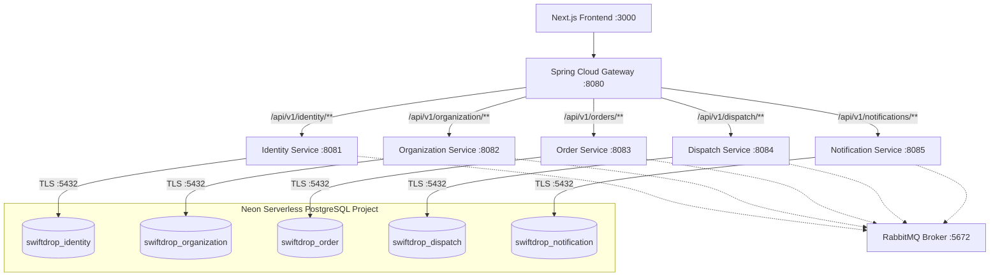

# SwiftDrop — Microservices Delivery Management Platform

SwiftDrop is a distributed logistics and delivery management platform built using a microservices architecture. It supports multi-branch logistics operations, courier assignment, delivery lifecycle tracking, customer notifications, and centralized administrative oversight.

All microservices persist data to dedicated, isolated databases hosted on **Neon PostgreSQL Serverless Cloud**, eliminating local database containers and volumes.

---

## Architecture Overview



---

## Services & Database Inventory

### Application Components (Dockerized)

| Component | Container / Service Name | Host Port | Internal Port | Technology |
|---|---|---|---|---|
| **Frontend** | `swiftdrop-frontend` | `3000` | `3000` | Next.js 14, React 18, TypeScript |
| **API Gateway** | `swiftdrop-api-gateway` | `8080` | `8080` | Spring Cloud Gateway (Reactive WebFlux) |
| **Identity Service** | `swiftdrop-identity-service` | `8081` | `8081` | Spring Boot 3.2, JPA, Flyway, PostgreSQL Driver |
| **Organization Service** | `swiftdrop-organization-service` | `8082` | `8082` | Spring Boot 3.2, JPA, Flyway, PostgreSQL Driver |
| **Order Service** | `swiftdrop-order-service` | `8083` | `8083` | Spring Boot 3.2, JPA, Flyway, PostgreSQL Driver |
| **Dispatch Service** | `swiftdrop-dispatch-service` | `8084` | `8084` | Spring Boot 3.2, JPA, Flyway, PostgreSQL Driver |
| **Notification Service** | `swiftdrop-notification-service` | `8085` | `8085` | Spring Boot 3.2, JPA, Flyway, PostgreSQL Driver |
| **RabbitMQ** | `swiftdrop-rabbitmq` | `5672` / `15672` | `5672` / `15672` | RabbitMQ 3 Management (AMQP & Dashboard) |

### Neon PostgreSQL Database Mapping

| Microservice | Assigned Neon Database | Default Port | Connection Type |
|---|---|---|---|
| **identity-service** | `swiftdrop_identity` | `5432` | Pooled (`-pooler`) / Direct TLS |
| **organization-service** | `swiftdrop_organization` | `5432` | Pooled (`-pooler`) / Direct TLS |
| **order-service** | `swiftdrop_order` | `5432` | Pooled (`-pooler`) / Direct TLS |
| **dispatch-service** | `swiftdrop_dispatch` | `5432` | Pooled (`-pooler`) / Direct TLS |
| **notification-service** | `swiftdrop_notification` | `5432` | Pooled (`-pooler`) / Direct TLS |

> **Note**: No local PostgreSQL containers or volumes are used. Each microservice maintains strict domain isolation by connecting exclusively to its assigned database.

---

## Environment Configuration

### 1. Copy Environment Template
```bash
cp .env.example .env
```

### 2. Configure Neon Credentials
In `.env`, set your shared Neon project endpoint or individual service endpoints:
```dotenv
# Shared Neon settings
NEON_HOST=ep-xxxx-xxxx-pooler.us-east-2.aws.neon.tech
NEON_PORT=5432
NEON_USER=neondb_owner
NEON_PASSWORD=your_secure_neon_password
NEON_SSL_MODE=?sslmode=require
NEON_DIRECT_HOST=ep-xxxx-xxxx.us-east-2.aws.neon.tech

# Microservice database assignments
IDENTITY_DB_NAME=swiftdrop_identity
ORGANIZATION_DB_NAME=swiftdrop_organization
ORDER_DB_NAME=swiftdrop_order
DISPATCH_DB_NAME=swiftdrop_dispatch
NOTIFICATION_DB_NAME=swiftdrop_notification
```

> **Security Warning**: The `.env` file is git-ignored and must never be committed to version control. Always maintain `.env.example` with placeholders only.

---

## Starting Guidelines (Environment Setup)

Before launching applications, ensure you have prerequisites installed for your target platform:
* **Docker & Docker Compose** (for containerized deployments)
* **Java 17+ & Maven** (if building backend microservices locally)
* **Node.js 18+ & npm/pnpm** (if running the frontend locally)

---

## Application Initialization & Startup Steps

### Method 1: Using Docker Compose & CLI Tool (`swiftdrop.sh`)

Place `swiftdrop.sh` inside the `infrastructure` folder next to `docker-compose.yml`, then make it executable:

#### **Linux / macOS**
```bash
cd infrastructure
chmod +x swiftdrop.sh
./swiftdrop.sh start       # Starts RabbitMQ + 5 services + Gateway + Frontend
```

#### **Windows (Git Bash / PowerShell)**
If using Git Bash:
```bash
cd infrastructure
chmod +x swiftdrop.sh
./swiftdrop.sh start
```
Alternatively, use Docker Compose manually from the root directory:
```bash
docker compose -f infrastructure/docker-compose.yml --env-file .env up -d --build
```

---

### Method 2: Initializing Backend Microservices & Frontend Separately

#### **Step A: Initialize Backend Services**
To compile all backend Spring Boot services and the API Gateway via Maven:

* **Linux / macOS:**
  ```bash
  mvn clean test-compile -f pom.xml
  ```
* **Windows (PowerShell):**
  ```powershell
  mvn clean test-compile -f pom.xml
  ```

To spin up only the backend services using Docker/Compose:
* **Linux / macOS / Windows:**
  ```bash
  ./infrastructure/swiftdrop.sh start backend
  ```

#### **Step B: Initialize Frontend Service (Next.js)**
Navigate to the frontend directory, install dependencies, and start the development server:

* **Linux / macOS / Windows:**
  ```bash
  cd frontend
  npm install
  npm run dev
  ```
  The Next.js frontend will be accessible at `http://localhost:3000`.

---

## CLI Management Reference (`swiftdrop.sh`)

### 1. Global Lifecycle Commands
```bash
./swiftdrop.sh start       # Start all services
./swiftdrop.sh stop        # Stop all containers
./swiftdrop.sh restart     # Restart all containers
./swiftdrop.sh down        # Remove all containers and network
./swiftdrop.sh status      # Check health/state of containers
```

### 2. Individual Container & Group Operations
Short names available: `identity`, `org`, `order`, `dispatch`, `notification`, `gateway`, `frontend`, `rabbitmq`.

```bash
./swiftdrop.sh rebuild order --mvn     # Recompile + rebuild image + recreate container
./swiftdrop.sh restart dispatch        # Restart dispatch service
./swiftdrop.sh logs order              # Tail logs for order service
./swiftdrop.sh rebuild backend --mvn   # Rebuild all backend services + gateway
./swiftdrop.sh rebuild frontend        # Rebuild frontend side only
```

---

## Health Checks & OpenAPI Documentation

### Gateway Health Endpoints
- Gateway itself: `http://localhost:8080/health`
- Identity Service: `http://localhost:8080/services/identity/health`
- Organization Service: `http://localhost:8080/services/organization/health`
- Order Service: `http://localhost:8080/services/orders/health`
- Dispatch Service: `http://localhost:8080/services/dispatch/health`
- Notification Service: `http://localhost:8080/services/notifications/health`

### Swagger UI Endpoints (Direct Access)
- Identity Service: `http://localhost:8081/swagger-ui.html`
- Organization Service: `http://localhost:8082/swagger-ui.html`
- Order Service: `http://localhost:8083/swagger-ui.html`
- Dispatch Service: `http://localhost:8084/swagger-ui.html`
- Notification Service: `http://localhost:8085/swagger-ui.html`

---

## Testing CRUD Operations

All services provide infrastructure verification endpoints (`test-items`) accessible directly or through the API Gateway:

### 1. Create a Test Item (POST)
```bash
curl -X POST http://localhost:8080/api/v1/identity/test-items \
  -H "Content-Type: application/json" \
  -d '{"name": "Auth Integration Item", "description": "Testing CRUD", "status": "ACTIVE"}'
```

### 2. List All Test Items (GET)
```bash
curl http://localhost:8080/api/v1/identity/test-items
```

---

## Troubleshooting Database Connectivity

1. **Authentication Failure (`PSQLException: password authentication failed`)**:
   - Verify `NEON_USER` and `NEON_PASSWORD` in your `.env` file.
2. **TLS / SSL Negotiation Error (`SSL connection required`)**:
   - Verify that `sslmode=require` is present in your connection string parameters.