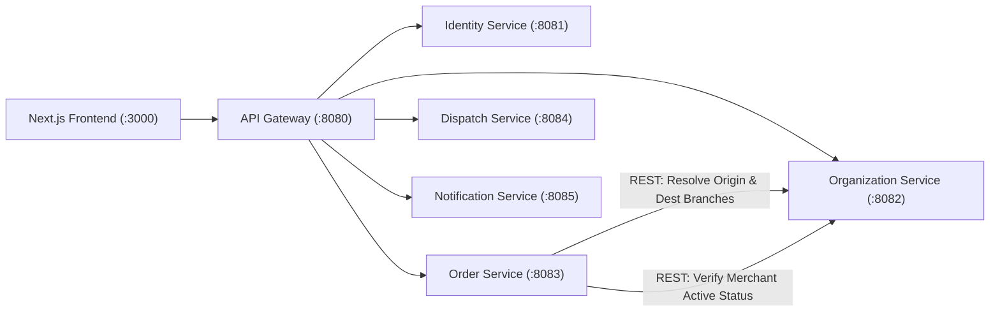

# SwiftDrop — Implementation Dependencies & Execution Plan

**Document:** `docs/implementation/IMPLEMENTATION_DEPENDENCIES.md`  
**Audit Date:** 2026-11-13  

---

## 1. Existing Database Schemas to Preserve

Per the architecture rules in `agents/agent.backend.md`, each microservice owns an isolated PostgreSQL database on Neon. **Existing Flyway migrations (`V1` through `V5`) must never be deleted or modified.** All new schema changes must be added as forward-only migrations (`V2__...`, `V4__...`, `V6__...`).

| Microservice | Database Name | Existing Flyway Migrations | Tables to Preserve | Next Migration Version |
|---|---|---|---|---|
| **Identity Service** (`:8081`) | `swiftdrop_identity` | `V1__create_test_items.sql` `V2__create_users_roles.sql` `V3__seed_roles.sql` `V4__convert_enums_to_varchar.sql` `V5__user_profile_lifecycle_tokens.sql` | `test_items`, `users`, `roles`, `user_roles`, `refresh_tokens`, `password_reset_tokens`, `email_verification_tokens` | `V6__...` (if needed) |
| **Organization Service** (`:8082`) | `swiftdrop_organization` | `V1__create_test_items.sql` `V2__create_branches.sql` `V3__create_service_areas.sql` | `test_items`, `branches`, `service_areas` | `V4__create_merchants_and_applications.sql` |
| **Order Service** (`:8083`) | `swiftdrop_order` | `V1__create_test_items.sql` | `test_items` | `V2__create_orders_pricing_and_history.sql` |
| **Dispatch Service** (`:8084`) | `swiftdrop_dispatch` | `V1__create_test_items.sql` | `test_items` | `V2__create_couriers_assignments_and_transfers.sql` |
| **Notification Service** (`:8085`) | `swiftdrop_notification` | `V1__create_test_items.sql` | `test_items` | `V2__create_notifications_and_webhooks.sql` |

---

## 2. Synchronous REST Inter-Service Communication

Synchronous HTTP calls are used only when an immediate response is required to complete a user transaction:

| Caller | Target Service | Endpoint | Purpose | Failure / Timeout Policy |
|---|---|---|---|---|
| **Order Service** (`:8083`) | **Organization Service** (`:8082`) | `POST /api/v1/branches/resolve` (or `/branches/resolve-route`) | Resolve eligible **origin branch** (pickup coordinates) and **destination branch** (drop-off coordinates) during quote and order creation. | 3s connect / 5s read timeout. Propagate HTTP `422 Unprocessable Entity` if pickup or destination is outside active service areas (`UD-05`). |
| **Order Service** (`:8083`) | **Organization Service** (`:8082`) | `GET /api/v1/merchants/{merchantUserId}/status` | Verify that a `MERCHANT` user's business profile is `APPROVED` and `ACTIVE` before accepting merchant delivery orders (Sec 4 Step 1B). | Reject order creation with `403 Forbidden` if merchant is not approved. |
| **Dispatch Service** (`:8084`) | **Organization Service** (`:8082`) | `GET /api/v1/branches/{branchId}` | Validate origin and destination branch references when creating inter-branch transfer manifests (`BD-03`). | Reject manifest creation with `404`/`422` if branch is inactive. |
| **All Services** | **JWT Validation** | Shared JWT secret (`JWT_SECRET`) | Validate `sd_access_token` cookie or `Authorization: Bearer` header locally using stateless JWT verification (matching `identity-service` claims: `sub`, `userId`, `roles`). | Return `401 Unauthorized` or `403 Forbidden` on invalid/expired token or insufficient role. |

---

## 3. Asynchronous RabbitMQ Event Architecture

All 5 microservices connect to the shared topic exchange **`swiftdrop.events`** (`RabbitMQConfig.java` in each service). Domain events decouple state changes across services:

| Event Routing Key | Producer Service | Consumer Service(s) | Trigger Operation | Consumer Action |
|---|---|---|---|---|
| `organization.merchant.approved.v1` | Organization (`:8082`) | Identity (`:8081`), Notification (`:8085`) | Head Office Admin approves merchant application. | Identity assigns `MERCHANT` role to the applicant user; Notification sends approval email. |
| `organization.merchant.rejected.v1` | Organization (`:8082`) | Notification (`:8085`) | Head Office Admin rejects merchant application. | Notification sends rejection notice with reason. |
| `order.delivery.created.v1` | Order (`:8083`) | Dispatch (`:8084`), Notification (`:8085`) | Customer or Merchant confirms a delivery order (`Confirmed`). | If `pickupMethod == COURIER_PICKUP` (`BD-04`/`BD-05`), Dispatch creates an unassigned pickup task at the origin branch; Notification sends order confirmation. |
| `order.delivery.cancelled.v1` | Order (`:8083`) | Dispatch (`:8084`), Notification (`:8085`) | Order is cancelled prior to pickup/completion. | Dispatch cancels any active courier assignment; Notification alerts customer/courier. |
| `dispatch.assignment.created.v1` | Dispatch (`:8084`) | Order (`:8083`), Notification (`:8085`) | Dispatcher assigns a pickup or last-mile courier. | Order transitions status to `Pickup Assigned` or `Out for Delivery`; Notification alerts courier and customer. |
| `dispatch.pickup.completed.v1` | Dispatch (`:8084`) | Order (`:8083`), Notification (`:8085`) | Courier confirms parcel collection (`markPickedUp`). | Order transitions status to `Picked Up` and appends history; Notification alerts sender/merchant. |
| `dispatch.branch.received.v1` | Dispatch (`:8084`) | Order (`:8083`), Notification (`:8085`) | Branch staff scan parcel at origin branch (from courier handover or customer branch drop-off `BD-04`) or destination branch. | Order transitions status to `At Origin Branch` or `At Destination Branch`. |
| `dispatch.transfer.dispatched.v1` | Dispatch (`:8084`) | Order (`:8083`), Notification (`:8085`) | Regular courier departs origin branch with transfer manifest (`BD-03`). | Order transitions all manifest parcels to `In Transit` and records custody handover. |
| `dispatch.transfer.received.v1` | Dispatch (`:8084`) | Order (`:8083`) | Destination branch receives and verifies transfer manifest (`BD-03`). | Order transitions manifest parcels to `At Destination Branch` and queues them for last-mile dispatch. |
| `dispatch.delivery.completed.v1` | Dispatch (`:8084`) | Order (`:8083`), Notification (`:8085`) | Courier submits Proof of Delivery (`BD-08`: recipient name + signature/photo). | Order transitions status to `Delivered` and records POD reference; Notification alerts sender, recipient, and merchant webhook. |
| `dispatch.delivery.failed.v1` | Dispatch (`:8084`) | Order (`:8083`), Notification (`:8085`) | Courier records failed attempt (`attemptNumber` 1, 2, or 3 per `BD-02`). | On attempts 1–2, Order transitions to `Delivery Failed`. On attempt 3 (`BD-02`/`BD-07`), Order transitions to `Pending Dispatcher Decision`; Notification alerts sender/merchant. |
| `dispatch.exception.decided.v1` | Dispatch (`:8084`) | Order (`:8083`), Notification (`:8085`) | Dispatcher records decision after 3 failed attempts (`BD-07`: `RETURN_TO_SENDER` or `APPROVED_RETRY`). | Order transitions to `Return to Sender` (or re-queues for delivery) and logs actor, timestamp, and reason. |

---

## 4. Recommended Implementation Order (Execution Plan)

To respect service dependencies, preserve existing functionality, and systematically replace frontend mocks with real backend integrations, implementation should proceed in the following five phases:

### Phase A — Shared JWT Security & Organization Service Completion (`services/organization-service`)
1. **Stateless JWT Filter for Resource Services:**
   - Add reusable Spring Security JWT validation (`sd_access_token` cookie + `Bearer` header) to `organization-service`, `order-service`, `dispatch-service`, and `notification-service` so role checks (`ADMIN`, `DISPATCHER`, `COURIER`, `MERCHANT`, `CUSTOMER`) are enforced on the backend.
2. **Dual Origin/Destination Branch Resolution:**
   - Extend `BranchResolutionController` / `BranchResolutionService` to support resolving both pickup (origin branch) and drop-off (destination branch) coordinates.
3. **Merchant Onboarding & Approval (`V4__create_merchants_and_applications.sql`):**
   - Implement `MerchantApplication` entity, repository, service, and controller in `organization-service`.
   - Publish `organization.merchant.approved.v1` to RabbitMQ and consume it in `identity-service` to grant the `MERCHANT` role.
   - Relocate the frontend Merchant Approvals UI from `/dispatcher/merchants` to the Head Office Administration / Organization portal and wire it to `/api/v1/organization/merchants/**`.

---

### Phase B — Order Service Backend & Customer Portal Integration (`services/order-service`)
1. **Database Schema (`V2__create_orders_pricing_and_history.sql`):**
   - Create `pricing_rules` (configurable base fee, per-km rate, per-kg rate, size multipliers per `BD-06`).
   - Create `delivery_orders` (including `tracking_number`, `pickup_method` [`COURIER_PICKUP` / `BRANCH_DROPOFF` per `BD-04`/`BD-05`], `payment_method` [`PREPAID` / `COD` per `BD-01`], `delivery_fee`, `cod_amount`, `origin_branch_id`, `destination_branch_id`, and 14-state `status`).
   - Create `order_status_history` (immutable audit trail of status transitions, actor, branch, and timestamps).
   - Create `order_payments` (`BD-01`).
2. **REST APIs & State Machine:**
   - Implement `POST /quote` (`BD-06`), `POST /` (Order Creation with synchronous call to Organization Service branch resolution), `GET /`, `GET /{id}`, `POST /{id}/cancel`, and `GET /tracking/{trackingNumber}`.
   - Add `/api/v1/tracking/**` route in `api-gateway/src/main/resources/application.yml`.
3. **Frontend Booking & Tracking Wiring:**
   - Update `frontend/src/schema/order.schema.ts`, `frontend/src/types/order.types.ts`, and `/book/page.tsx` to include Pickup Method (`COURIER_PICKUP` vs `BRANCH_DROPOFF`) and Payment Method (`PREPAID` vs `COD`).
   - Connect `frontend/src/api/services/orders.api.ts` directly to the live `order-service` endpoints.

---

### Phase C — Dispatch Service Backend: Courier Tasks, POD & 3-Attempt Escalation (`services/dispatch-service`)
1. **Database Schema (`V2__create_couriers_assignments_and_transfers.sql`):**
   - Create `courier_profiles` (availability, vehicle, branch, active workload).
   - Create `dispatch_assignments` (distinguishing `PICKUP`, `LAST_MILE`, and `INTER_BRANCH_TRANSFER` task types).
   - Create `delivery_attempts` (recording attempt number `1..3`, failure reason, notes, timestamp per `BD-02`).
   - Create `proof_of_delivery` (recipient name, signature/photo reference, courier ID, timestamp per `BD-08`).
   - Create `dispatcher_decisions` (recording dispatcher decision after 3 failed attempts per `BD-07`).
2. **RabbitMQ Integration with Order Service:**
   - Consume `order.delivery.created.v1` in `dispatch-service` to populate the unassigned queue.
   - Publish `dispatch.assignment.created.v1`, `dispatch.pickup.completed.v1`, `dispatch.delivery.completed.v1`, `dispatch.delivery.failed.v1`, and `dispatch.exception.decided.v1` to `order-service` so `order-service` updates the authoritative parcel status.
3. **Frontend Dispatcher & Courier Wiring:**
   - Wire `frontend/src/api/services/courier.api.ts`, `assignmentService.ts`, `deliveriesApi.ts`, `assignmentsApi.ts`, `activeDeliveriesApi.ts`, and `couriersApi.ts` to the real `/api/v1/dispatch/**` endpoints.

---

### Phase D — Inter-Branch Transfer Manifests & Branch Custody (`BD-03`)
1. **Backend Transfer Manifests (`services/dispatch-service`):**
   - Implement `transfer_manifests` and `transfer_manifest_items` tables and endpoints (`POST /transfers`, `POST /transfers/{id}/assign`, `POST /transfers/{id}/dispatch`, `POST /transfers/{id}/receive`).
   - Ensure regular couriers can be assigned to transfer manifests (`BD-03`) and every physical handover updates parcel custody history.
2. **Frontend Transfer Manifest UI:**
   - Add Branch / Dispatcher Transfer Manifest management views and Courier transfer handover actions.

---

### Phase E — Notification Service Event Consumers & End-to-End Verification (`services/notification-service`)
1. **Database Schema (`V2__create_notifications_and_webhooks.sql`):**
   - Create `notifications` and `webhook_deliveries` tables.
2. **Event Consumers:**
   - Bind `notification.events.queue` to `order.#`, `dispatch.#`, `organization.#`, and `identity.#` on `swiftdrop.events`.
   - Persist in-app notifications, log/send email alerts, and trigger merchant webhooks with idempotency and retry handling.
3. **End-to-End Integration Testing:**
   - Verify the complete parcel flow from Customer Booking &rarr; Branch Resolution &rarr; Courier Pickup / Branch Drop-off &rarr; Inter-Branch Transfer &rarr; Last-Mile Delivery / POD &rarr; 3-Attempt Escalation &rarr; Notifications.
